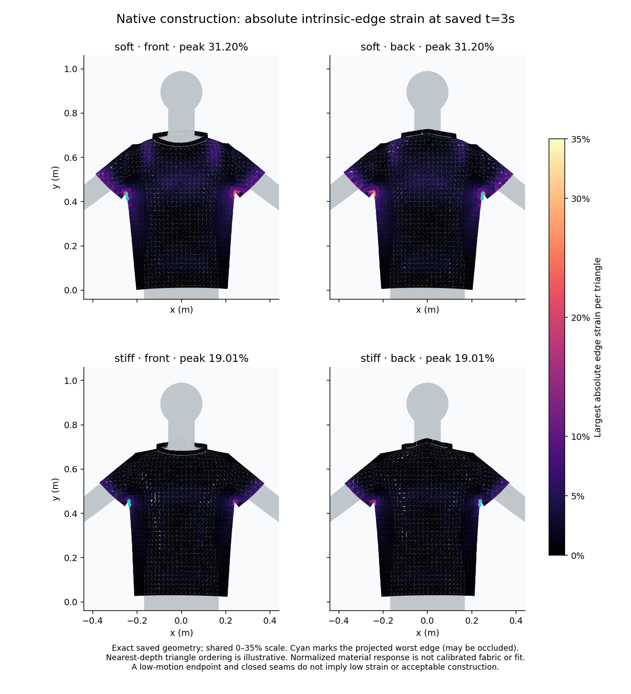

# Locate the native garment's construction strain — #290

Low saved-interval motion and small seam gaps do not show that the garment's construction is satisfactory. This follow-through locates the existing three-second peak using the exact retained native geometry, original intrinsic rest lengths and authored part/triangle provenance. It does not change the solver, patterns, stitches, contact or any frozen evidence.

The [complete requested-four serial-pair archive](GARMENT_DURATION_STUDY.md) remains the source: official ZIP SHA256 `af0c6e074e4625bdcb33d9180411ad1a463ba316dd2e96e1e06c1c2c1933289c`, artifact12183171227, run39243425408, saved frame180 (3s). [Numerical diagnostics](results/garment-construction-three-second.json) include signed extension/compression, nearest-rank unweighted absolute-strain median/p95, worst-edge indices, incident parts and original render-triangle IDs. Stitches retain row/endpoints, endpoint-part and triangle provenance, global and per-part gaps. Shared edges count once globally and in every incident part; part counts overlap and must not be summed.

| Part | Unique incident edges | Young500 max absolute strain | Young500 p95 | Young2000 max absolute strain | Young2000 p95 |
| --- | ---: | ---: | ---: | ---: | ---: |
| Front | 2965 | 31.196% | 4.010% | 19.012% | 1.920% |
| Back | 3072 | 31.196% | 3.941% | 19.012% | 1.829% |
| Left sleeve | 421 | 21.637% | 8.833% | 13.793% | 6.257% |
| Right sleeve | 439 | 25.377% | 9.535% | 16.404% | 6.224% |
| Neckband | 81 | 1.494% | 1.230% | 0.533% | 0.349% |

Both cases' largest edge is native[561,571], shared by the front and back near an underarm junction. Its rest length is14.510mm and signed strain is positive (extension). Vertex571 is also incident to sleeveRight triangles; sleeve maxima are separately located in the JSON. This spatial observation suggests investigating the underarm construction and its original rest metric next. It does not identify a causal defect, justify rewriting rest lengths, or establish a physical strain tolerance. The body and saved geometry locate this at an underarm, not the shoulder.



The figure uses exact triangles, common0–35% color scale and front/back projections. Each triangle's color is its largest absolute intrinsic-edge strain; cyan marks the projected worst edge, even if occluded. Mean-depth ordering is illustrative and cannot prove continuous contact. The scale is a visualization choice, not an acceptance threshold. Maximum strain equals the existing trajectory audit's final metric exactly.

Reproduce the independently admitted numerical receipt and optional figure:

```sh
python3 docs/research/ppf-cpu/garment_construction_diagnostics.py docs/research/ppf-cpu/results/garment-duration-four.zip.xz /tmp/construction.json --duration-profile four
python3 docs/research/ppf-cpu/render_garment_strain.py docs/research/ppf-cpu/results/garment-duration-four.zip.xz docs/research/ppf-cpu/results/garment-duration-four.zip.xz /tmp/construction.png
```

The numerical path uses only the standard library; rendering optionally needs NumPy and Matplotlib. Focused tests cover shared-edge provenance, overlapping per-part counts, signed compression/extension, nearest-rank percentiles, seam endpoint attribution, incomplete/nonfinite/degenerate inputs and exact frozen-pair reproduction. Physical fabric calibration, seam/construction acceptance, representative garment/body coverage and shipping-engine adoption remain open. The original requested-one serial timeout is unchanged; the separate fixed-material protocol is [tracked independently](GARMENT_FIXED_MATERIAL_STUDY.md). Clothing remains ACTIVE and project #8 remains skipped.

Follow-through: [intrinsic triangle principal stretch](GARMENT_PRINCIPAL_STRAIN.md) measures all in-plane directions and rest-area-weighted distributions. It finds larger peak extension40.885/26.339% at another underarm triangle; the edge metrics above retain their original meaning and values.
