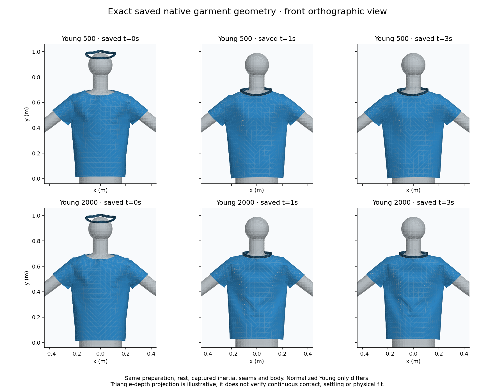

# Canonical-mesh three-second observation — #290

## Actual outcome

The requested-four environment completes Young500/2000 through three seconds:181saved frames each. The requested-one environment reaches the unchanged300-second whole-pair supervisor limit: Young500 completes181frames, while Young2000 retains168frames through2.783333seconds. Cleanup leaves no child processes. The overall native [run39243425408](https://github.com/twangyal/projects-monorepo/actions/runs/39243425408) therefore fails; its requested-four job succeeds. The timeout is retained as partial evidence, never promoted to a completed pair.

Source `f844c08d9a1a0c2d922d0495513d74f09e61ece4` is a protocol-only child of the reviewed `8e1dbec3a287c2ad3a68db8305818eb1c223175c` controls. The explicit `--relaxation-study` mode requires180intervals, cleared-warm preparation, browser inertia, normal stitches, two materials and uniform requested1/4-thread environment. Existing18/60interval and same-material modes retain their bounds. No timestep, contact, seam, rest geometry, mass or body changes are admitted. The exact research-only canonical mesh patch is unchanged.

## Complete and partial evidence

| Requested environment | Outcome / saved frames (500,2000) | Verified native files | Supervisor including cleanup |
| --- | --- | --- | --- |
| 1 | Timeout;181,168 | 899 | 300.045s; exit124;0children |
| 4 | Complete pair;181,181 | 926 | 168.750s; exit0;0children |

The partial archive retains its last complete vertex/time record, but the corresponding final per-frame statistics sidecar was not written before termination. All retained files are checksum-verified; replay never unpickles frontend state. Separate hosts and requested environment settings do not establish causal thread performance or measured native worker counts.

| Environment | Official artifact / original ZIP bytes | Official ZIP SHA-256 | Permanent lossless storage |
| --- | --- | --- | --- |
| 1 | [12182494397](https://github.com/twangyal/projects-monorepo/actions/runs/39243425408/artifacts/12182494397);13,155,997 | `48b0ccfc4232242081babfc42c04ec18e6cb17835e9dc962ba601f4e7c294d4b` | [ZIP.xz](results/garment-duration-one.zip.xz),12,226,292bytes; SHA-256 `e5a457911ee98259b959428b4f0f1812930e8436174b5a4214853b05b2794c4e` |
| 4 | [12183171227](https://github.com/twangyal/projects-monorepo/actions/runs/39243425408/artifacts/12183171227);13,512,242 | `af0c6e074e4625bdcb33d9180411ad1a463ba316dd2e96e1e06c1c2c1933289c` | [ZIP.xz](results/garment-duration-four.zip.xz),12,571,576bytes; SHA-256 `5d06260e082901f0df197d0f4e94878bda481f375bb00e208b5827f22e3a33f5` |

The connector's16MiB request limit prevents uploading these raw ZIPs as base64. XZ is a lossless outer storage wrapper: standard-library decompression recovers every original ZIP byte, whose official digest is then verified by the existing semantic replay. Original ZIP membership, logs, binary frames and manifests are unchanged. Wrapper compression bytes are retained, not promised reproducible across LZMA versions. [One-profile replay](results/garment-duration-one-replay.json), [four-profile replay](results/garment-duration-four-replay.json), and [cross-host comparison](results/garment-duration-comparison.json) distinguish the actual native outcomes.

```sh
python3 docs/research/ppf-cpu/garment_material_cohort_audit.py docs/research/ppf-cpu/results/garment-duration-one.zip.xz --profile one --observation three-second
python3 docs/research/ppf-cpu/garment_material_cohort_audit.py docs/research/ppf-cpu/results/garment-duration-four.zip.xz --profile four --observation three-second
python3 -m unittest discover -s docs/research/ppf-cpu -p test_garment_duration_audit.py
```

An audit command verifies evidence integrity and can return zero for a correctly retained timeout. Read `native_outcome` and `two_material_bounded_motion_complete`; the one-profile value is explicitly false. The auditor freezes each actual outcome, saved counts and completed-case set. Tests refuse a re-signed promotion of the timeout, nine altered duration/physics/source controls, and inappropriate shorter/same-material archives. Separate storage tests refuse corrupt/truncated wrappers.

## What the saved geometry establishes

All native physical input binaries and scene metadata match the repaired [one-second material cohort](GARMENT_MATERIAL_COHORT.md); only the session frame limit changes60→180. Within each pair only the Young binary differs. Both materials' first61frames match their one-second references on each host. All available cross-host prefixes are byte-identical:181soft frames and168stiff frames. There is no completed two-host three-second cohort.

The complete requested-four pair provides these saved-interval RMS secant speeds (millimetres per second):

| Saved window | Young500 RMS | Young2000 RMS | Young500 maximum | Young2000 maximum |
| --- | --- | --- | --- | --- |
| 0–1s | 148.384073 | 164.331829 | 3213.008838 | 3441.785678 |
| 1–2s | 0.315977 | 0.461760 | 9.359357 | 48.175290 |
| 2–3s | 0.142056 | 0.023409 | 8.868821 | 1.915551 |

The one-profile stiff final window has only47intervals (2–2.783333s); its replay labels that actual duration rather than calling it a full one-second window.

| Complete pair at final saved3s | Young500 | Young2000 |
| --- | --- | --- |
| Last saved-interval RMS secant speed | 0.173945mm/s | 0.028685mm/s |
| Last saved-interval maximum secant speed | 7.505844mm/s | 1.048501mm/s |
| Maximum absolute intrinsic-edge strain | 31.1955% | 19.0122% |
| Maximum stitch gap | 1.421833mm | 1.442323mm |
| Cloth/body threshold violations at3.5mm | 0 | 0 |
| Collar/shirt threshold violations at0.5mm | 0 | 0 |

Final inter-material vertex RMS is18.204159mm. Motion is lower in the later observed windows, while substantial intrinsic strain remains. These are finite saved intervals and final snapshots, not instantaneous velocity, sustained settling, continuous-time contact, full cloth self-contact, inside/outside correctness, calibrated fabric or physical fit. Collar/shirt queries include stitched neighborhoods and do not reproduce native contact-policy filtering. No acceptance tolerance was invented from these observations.



The projection uses actual retained blueprint/triangle coordinates and a common scale. It illustrates construction rather than proving contact or fit. With optional NumPy/Matplotlib, reproduce it directly from the lossless archive using `python3 docs/research/ppf-cpu/render_garment_snapshot.py docs/research/ppf-cpu/results/garment-duration-four.zip.xz /tmp/duration.png --frames 0 60 180`; independent replay remains standard-library-only.

## Remaining work

Resolve the recorded serial-pair runtime limitation with an explicitly declared bounded study, for example separate fixed-material sessions; retain this original timeout and its300-second whole-pair limit. Then evaluate sustained settling and seam/construction quality, representative supported garments/body settings and final drape/export behavior, timestep/resolution sensitivity and corresponding physical references. Do not rewrite rest lengths to make the prepared appearance stress-free or relax physical contacts. Clothing remains ACTIVE at `apps/clothing-studio`; the shipping preview is unchanged. Issue #290 stays open and project #8 stays skipped.
