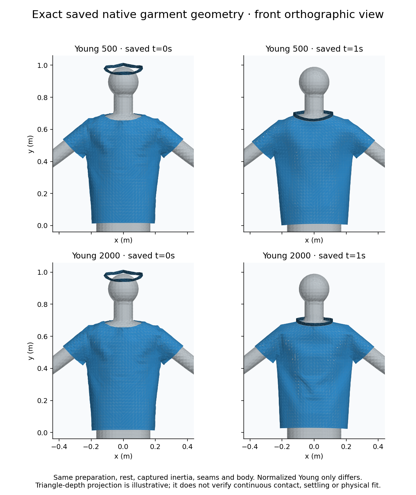

# Declared canonical-mesh material cohort — #290

## Outcome and fixed protocol

The repaired Young500/2000 cohort completes both materials on two recorded requested1/4-thread environments. All61saved frames per material are byte-identical across these two observed hosts. Soft500 also matches all61frames of the frozen canonical500 control. The materials have different motion: maximum saved-vertex difference34.941mm, whole-trajectory RMS17.607mm, final vertex RMS18.165mm. This is bounded normalized parameter response for one synthetic garment/preparation/body, not measured fabric calibration, a population tolerance or a shipping-backend decision.

Native [run39241347732](https://github.com/twangyal/projects-monorepo/actions/runs/39241347732) at `a340f5d18ac5b2b7eaf50eb0c73d750fe2fd7907` passes both jobs. The exact three-token research patch, upstream revision, original/modified mesh source, patch and complete upstream diff are verified independently. The workflow records the actual executable digest; replay does not retain/rebuild that executable. The shipping browser solver is unchanged.

The ordinary `soft`/`stiff` cases use cleared warm preparation, browser inertia, normal stitches/contacts,60intervals/61saved frames, fresh per-job caches and the existing300-second whole-pair supervisor. Rest, body, seams, object/session controls and native input bytes match the frozen original one-second experiment. Only `param/tri-young-mod.bin` differs within each pair. Both jobs report no remaining child processes; supervisor wall times are112.748/100.079seconds. Separate hosts and one pair/profile do not isolate causal thread effects; thread values are requests, not measured worker counts or a performance comparison.

## Retained evidence

| Requested environment | Native artifact | Bytes | SHA-256 | Replay |
| --- | --- | --- | --- | --- |
| 1 | [12182450858](https://github.com/twangyal/projects-monorepo/actions/runs/39241347732/artifacts/12182450858) / [full ZIP](results/garment-material-one.zip) | 6,878,193 | `e41f7f362b46440f1d218398fae5e5a74be500f0af546c04a35e3dc248d960a9` | [JSON](results/garment-material-one-replay.json) |
| 4 | [12182535783](https://github.com/twangyal/projects-monorepo/actions/runs/39241347732/artifacts/12182535783) / [full ZIP](results/garment-material-four.zip) | 6,876,068 | `adb968450a6e82b26dd50601c6bfcb282ac12c71f279b054af6f9d4860ba1818` | [JSON](results/garment-material-four-replay.json) |

Each archive retains446verified native files and122raw vertex frames, plus full source/build/dependency/CPU/affinity/thread/provenance records. All native float32 coordinates, initial values, timing, completion, captured mass, commands, sidecars and process cleanup are independently admitted. Original unpatched and same-material archives remain unchanged. Three targeted archive tests pass, including10re-signed semantic counterexamples and refusal of unpatched/same-material evidence.

```sh
python3 docs/research/ppf-cpu/garment_material_cohort_audit.py docs/research/ppf-cpu/results/garment-material-one.zip --profile one
python3 docs/research/ppf-cpu/garment_material_cohort_audit.py docs/research/ppf-cpu/results/garment-material-four.zip --profile four
python3 -m unittest discover -s docs/research/ppf-cpu -p test_garment_material_cohort_audit.py
```

## One-second diagnostics

Both environments produce exactly the same saved geometry and diagnostics:

| Final saved observation | Young500 | Young2000 |
| --- | --- | --- |
| Maximum absolute intrinsic-edge strain | 31.1633% | 19.0058% |
| Maximum stitch gap | 1.421796mm | 1.442314mm |
| Last saved-interval RMS secant speed | 0.890877mm/s | 1.628431mm/s |
| Last saved-interval maximum secant speed | 5.129654mm/s | 30.571204mm/s |
| Cloth/body triangle threshold violations at3.5mm | 0 | 0 |
| Collar/shirt threshold violations at0.5mm | 0 | 0 |

Threshold results apply only to that final saved snapshot. Collar/shirt queries include stitched neighborhoods and do not reproduce native contact-policy filtering; neither query establishes full cloth self-contact, inside/outside correctness or continuous-time safety. High intrinsic strain and the declared detached-collar initialization remain construction/calibration questions. Low final saved secants alone do not establish sustained settling or instantaneous velocity.



The projection uses the retained blueprint and raw saved coordinates, with a common scale and triangle-depth ordering; it is illustrative, not a contact/fit test. To reproduce it, install optional NumPy/Matplotlib and run `python3 docs/research/ppf-cpu/render_garment_snapshot.py docs/research/ppf-cpu/results/garment-material-one.zip /tmp/material.png --frames 0 60`. Independent replay/tests remain standard-library-only.

The prerequisite for the [explicit three-second observation](GARMENT_DURATION_STUDY.md) is now met. That study changes only the admitted frame limit, preserves the300-second pair supervisor, and tests the shared first-second prefix and subsequent motion windows. Broader repetitions, representative garments/bodies, construction quality, timestep/resolution sensitivity and independent physical references remain open in #290. Clothing stays ACTIVE; project #8 remains skipped.
