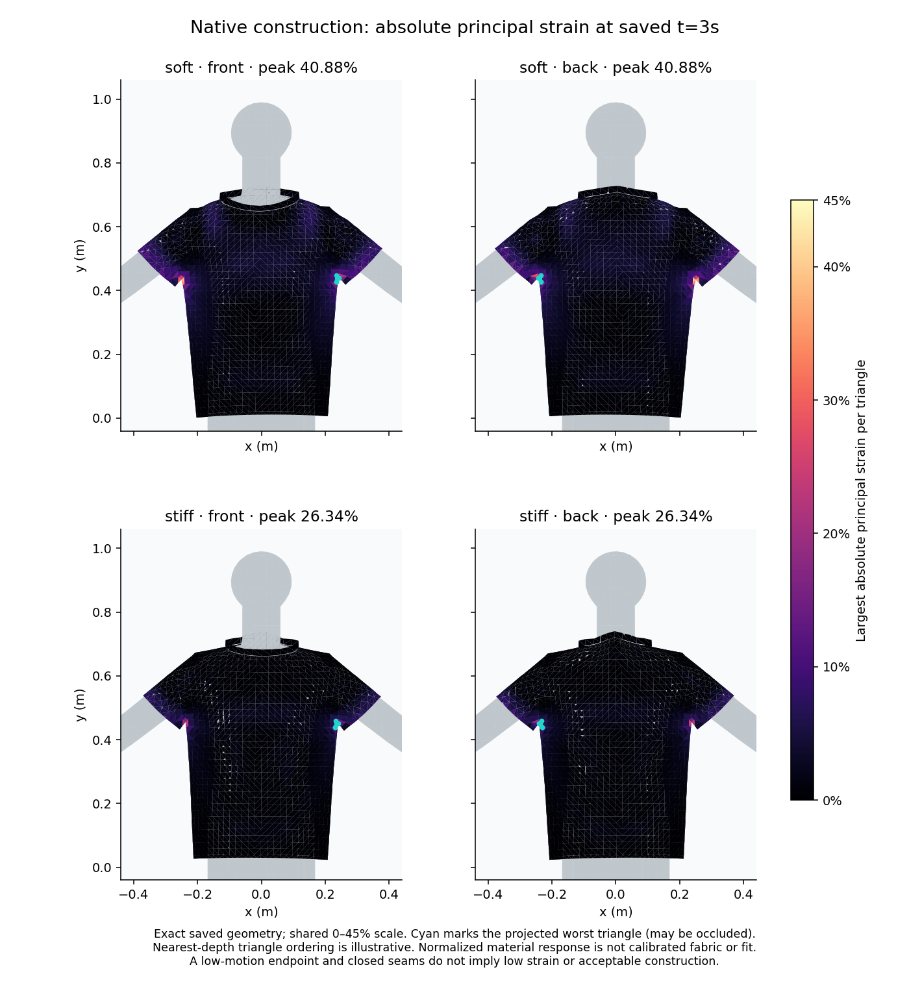

# Intrinsic triangle stretch in the native garment — #290

The completed fixed-material sessions reproduce the same final edge-strain peaks as the previous full duration pair. Edge sampling, however, measures only the three edge directions of each triangle. Before changing construction or selecting a backend, this follow-through measures the largest and smallest stretch in **any** in-plane direction of each unchanged intrinsic rest triangle.

This is a saved-geometry diagnostic. It changes no native or browser physics, material coefficient, rest length, seam, body or preparation, and imposes no new acceptance threshold. The original edge diagnostics remain correct for their stated metric and are retained unchanged.

## Derivation and checks

Let rest edges be `r1,r2`, solved edges `s1,s2`, `L=|r1|`, `projection=(r1·r2)/L` and `height=|r1×r2|/L`. An orthonormal rest basis gives the affine deformation gradient columns:

```
f0 = s1 / L
f1 = (s2 - projection*f0) / height
F  = [f0 f1]   (3×2)
```

The square roots of the two eigenvalues of `FᵀF` are principal stretches. Engineering strain is stretch minus one; maximum extension and compression are reported separately. The larger eigenvalue uses the symmetric2×2 closed form; the smaller stretch uses `|f0×f1| / maximum_stretch` to avoid subtractive cancellation. The cross-product magnitude is also the unsigned solved/rest area ratio. Rest triangles at or below1e−18m² refuse as a numerical guard, not a physical criterion. A collapsed solved triangle reports zero minimum stretch/area and100% compression; it is not silently discarded.

Per-part and whole-garment p50/p95 are weighted by **original rest area**. Sort absolute principal strain and take the first value whose cumulative rest area reaches the requested fraction. This differs from the earlier unweighted edge-count percentile; those percentile values are not the same statistic. Faces belong to one authored part, so their rest areas can be summed without the shared-edge overlap in the edge report.

Analytic tests cover rigid3D motion, a rotated reference, known2×/0.5× stretch, simple shear with singular values `(sqrt(5)±1)/2`, triangle permutations, rest-area weighting, collapse, invalid inputs and exact retained-report reproduction. A reflection test explicitly demonstrates the absence of an orientation/inversion sign: singular values alone cannot identify a reflected/folded face. Independent review additionally compared **all4480faces per material** using NumPy SVD of an ambient `S @ pinv(R)` construction: maximum singular-value discrepancy1.33e−15. Permutations and arbitrary3D rigid transformations also agreed, as did independent area-weighted percentiles and source provenance.

## Retained three-second results

The CLI first independently audits the registered official archive before reading its final frame180. Sources are [one-soft](results/garment-fixed-one-soft.zip), SHA256 `17e59a70605c1abcec179be032021ef76431bfacc52240474878969d8a7adc1a`, and [one-stiff](results/garment-fixed-one-stiff.zip), SHA256 `1ea8c42c24277701aeb88289c5d67c81c4947e53e7926475f9b6fc8ff5c8c5d4`, from [run39283037590](https://github.com/twangyal/projects-monorepo/actions/runs/39283037590). Both materials' full trajectories already match across the observed hosts, so these geometry-derived results apply to those matching final frames as well. No additional native solve is claimed.

| Final saved-frame metric | Young500 | Young2000 |
| --- | ---: | ---: |
| Maximum sampled absolute edge strain |31.1955%|19.0122%|
| Maximum principal extension |40.8850%|26.3387%|
| Maximum principal compression |2.9645%|2.1752%|
| Rest-area-weighted absolute principal p50 |1.5840%|0.6382%|
| Rest-area-weighted absolute principal p95 |6.4379%|3.7552%|
| Maximum unsigned area ratio |1.505136|1.311029|
| Zero-area solved triangles |0|0|
| Total unchanged rest area |0.831797325m²|0.831797325m²|
| Total final solved area |0.853645166m²|0.838951832m²|

Both peak principal-extension faces are native triangle3091, authored `back` triangle1173, vertices[1639,1640,643], near an underarm junction. Rest area is0.0001m². The soft/stiff maximum stretches are1.408849841/1.263387458. The largest edge metric occurs at another underarm location; principal stretch is not constrained to a sampled edge direction, so the larger result and different peak location are expected mathematical possibilities, not contradictory evidence.

| Part | Young500 peak extension | Young500 area-weighted absolute p95 | Young2000 peak extension | Young2000 area-weighted absolute p95 |
| --- | ---: | ---: | ---: | ---: |
| Front |38.243%|5.273%|24.371%|2.300%|
| Back |40.885%|4.783%|26.339%|2.268%|
| Left sleeve |27.924%|10.334%|18.543%|7.064%|
| Right sleeve |34.875%|10.750%|22.703%|7.202%|
| Neckband |1.494%|1.328%|0.561%|0.548%|

Full summaries, maxima, area ratios and ten worst faces retain exact source identities in [soft JSON](results/garment-principal-soft.json) and [stiff JSON](results/garment-principal-stiff.json). The figure uses exact retained triangles, a shared0–45% scale and projected peak-face outlines, which may be occluded. Mean-depth triangle sorting is illustrative, and neither the color scale nor the observed maxima establish a physical tolerance.



## Reproduce

```sh
python3 docs/research/ppf-cpu/garment_principal_strain.py docs/research/ppf-cpu/results/garment-fixed-one-soft.zip /tmp/principal-soft.json --profile one-soft
python3 docs/research/ppf-cpu/garment_principal_strain.py docs/research/ppf-cpu/results/garment-fixed-one-stiff.zip /tmp/principal-stiff.json --profile one-stiff
python3 -m unittest discover -s docs/research/ppf-cpu -p 'test_garment_principal_strain.py'
python3 docs/research/ppf-cpu/render_garment_strain.py docs/research/ppf-cpu/results/garment-fixed-one-soft.zip docs/research/ppf-cpu/results/garment-fixed-one-stiff.zip /tmp/principal.png --metric principal
```

Numerical replay uses only the standard library; rendering optionally uses NumPy/Matplotlib. Default `--metric edge` preserves the existing edge visualization; principal mode is explicit.

## Consequence for the next milestone

The existing candidate's deformation is more concentrated and larger than edge sampling alone indicates. Keep construction quality open and investigate underarm pattern/topology, body-contact geometry and discretization deliberately before broader garment/body admission or adoption. This observation does not isolate a causal defect or justify rewriting rest lengths, increasing stiffness to hide distortion, relaxing contact, or choosing a physical strain threshold. Constitutive stress, measured fabric calibration, inversion, continuous-time collision, convergence, sustained settling, comfort, manufacturability and physical fit are unverified. The original serial timeout remains failure. Clothing remains ACTIVE; project#8 stays skipped.
